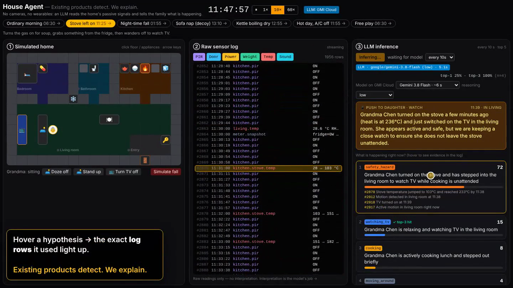

# House Agent — passive home sensing that *explains*

> **Existing products detect. We explain.**
> Built at cOmpiled-18 (YC Startup School Hackathon, Taipei) for YC RFS *AI for the Aging Population*. LLM inference on **GMI Cloud**.

## Demo video (80 s, with voiceover)

[](docs/demo.mp4)


https://github.com/user-attachments/assets/046969ad-fc53-4adb-a8e4-fcfe3ad7b24f


▶ **[Watch the demo (docs/demo.mp4)](docs/demo.mp4)** — recorded from the running app; every inference on screen is a live GMI Cloud response.
It shows: the stove left on → `safety_hazard` ranked #1 with its evidence rows highlighted; a sofa nap → `resting` (not a fall); a 2 am fall → `possible_fall` ranked #1; and switching models live.
The voiceover is synthetic (Piper TTS).

## Problem

Taiwan is a super-aged society and more elders live alone. Cameras feel like surveillance; wearables get left on the nightstand.
Yet the home already knows what is going on: the rice cooker, the hot-water pot, the fridge door, the mattress.
Rule-based "no motion for 15 min → alarm" systems drown families in false alarms: in real data from a senior living alone
(CASAS hh101, 60 days) there are on average **5.8 daytime gaps ≥15 min with no motion per day** while the person is fine.

## What the demo shows

| ① Simulated home | ② Raw sensor log | ③ LLM inference |
|---|---|---|
| Drive Grandma around (click floor / appliances, arrow keys) or play a scenario | Every raw reading streams in, with a stable `#id`. No interpretation. | Every 30 s the model reads the log + today's summary + 14-day personal baseline + memory and returns **5 ranked hypotheses with scores and cited evidence** |

- Hover a hypothesis → the log rows it cites light up (explainability).
- Alert level + the push message the daughter would get.
- History timeline + **top-1 / top-3 accuracy vs. the simulator's ground truth** (the model never sees ground truth).
- Scenarios: ordinary morning, stove left on, night-time fall, sofa nap (decoy: long stillness that is *not* a fall), kettle boiling dry, hot day with A/C off, free play.
- Badge shows **LLM** vs **Fallback (rules)** honestly. Without a key / network the rule-based fallback keeps the demo running.

## Architecture

```
Browser (Next.js client)                                   Server (Next.js route)
┌───────────────────────────────┐                         ┌────────────────────────────┐
│ Sim (1 tick = 1 sim second)   │                         │ POST /api/infer            │
│  elder + appliances + physics │──raw LogEntry──┐        │  openai SDK → GMI Cloud    │
│  noisy PIR ON/OFF             │                ▼        │  (OpenAI-compatible)       │
│ Log panel ◄── zustand store ──┤ buildContext():         │  zod-validate JSON         │
│ Inference panel               │  • last 45 min of log   │  retry once, normalize     │
└───────────────────────────────┘    (PIR → 1 line/min)   │  5 hyps, scores sum 100    │
                                   • today summary vs.    └─────────────┬──────────────┘
                                     14-day baseline (computed by code) │ fail / no key
                                   • tag-retrieved past days + profile  ▼
                                   • earlier inferences   rule-based fallback (client)
```

Stack: Next.js (App Router) + TypeScript, Tailwind, `motion`, `zustand`, `openai` SDK (base URL → GMI Cloud), `zod`.

## Run

```bash
npm install
cp .env.example .env.local   # fill LLM_API_KEY and LLM_MODEL (GMI Cloud); leave empty for fallback mode
npm run dev                  # http://localhost:3000
```

Only **`LLM_API_KEY`** (your GMI Cloud key, server-side only) is required. Leave it empty for fallback mode.

The **model and reasoning effort are chosen in the UI** (③ panel), from an allow-list in `lib/models.ts`.
Measured on GMI Cloud with a real ~3.5k-token prompt (stove scenario):

| Model | Reasoning | Latency | Top-1 on the stove prompt |
|---|---|---|---|
| `google/gemini-3.8-flash` (default) | low | ~6 s | safety_hazard ✓ |
| `google/gemini-3.5-flash-lite` | — | ~6 s | safety_hazard ✓ |
| `zai-org/GLM-5.3-Flash` | low | ~13 s | safety_hazard ✓ |
| `deepseek-ai/DeepSeek-V4.1-Flash` | low | ~17 s | safety_hazard ✓ |

Inference runs every **10 / 15 / 30 / 60 s** (selectable in the panel, default 30 s), measured from the start of each request; requests never overlap, so a slow model simply runs back-to-back.

With full ("default") thinking, every model we tried took 12–18 s or more, so `low` is the default. The panel shows top-1 accuracy and mean latency per model once you have tried more than one.

## Sensor assumptions (and the hardware each needs)

| Signal | Hardware |
|---|---|
| `<room>.pir` ON/OFF | PIR motion sensor per room (movement only; a still person is invisible) |
| `kitchen.fridge.door`, `entry.front_door` | door contact sensors |
| `bedroom.bed.pressure` | mattress pressure pad |
| `*.power` (fridge, kettle, rice cooker, TV, A/C), `meter.snapshot` | circuit-level power metering / smart plugs |
| `kitchen.stove.temp` | heat sensor above the gas stove (gas has no power signal) |
| `living.temp` | room thermometer |
| `kitchen.kettle.weight`, `bedroom.pillbox.weight`, `entry.key_hook.weight` | load cells / smart scale base (quantities need this hardware) |
| `bathroom.toilet.flush` | acoustic flush sensor |

PIR noise follows real data: ~100 triggers/hour while sitting watching TV, occasional triggers while asleep, none while lying still after a fall.

## Data sources / references

- **CASAS hh101** (WSU, Zenodo record 15708568): a senior living alone, 60 days, ~3,700 PIR/door events per day. Used for the noise model and the false-alarm base rate (5.8 / 2.4 / 1.0 daytime no-motion gaps per day of ≥15 / 30 / 60 min).
- **UCI "ADLs Recognition Using Binary Sensors"** (Ordóñez): binary sensors incl. flush, mattress pressure, fridge door. Non-commercial license; used only for design reference.
- The 14-day history and the resident profile are **synthetic**.

## Honest limitations

- Everything runs on a simulator; no real hardware is connected in this demo.
- Accuracy shown is against the simulator's ground truth for the scenarios played, not a clinical validation.
- No medical diagnosis; the model is instructed not to make one.
